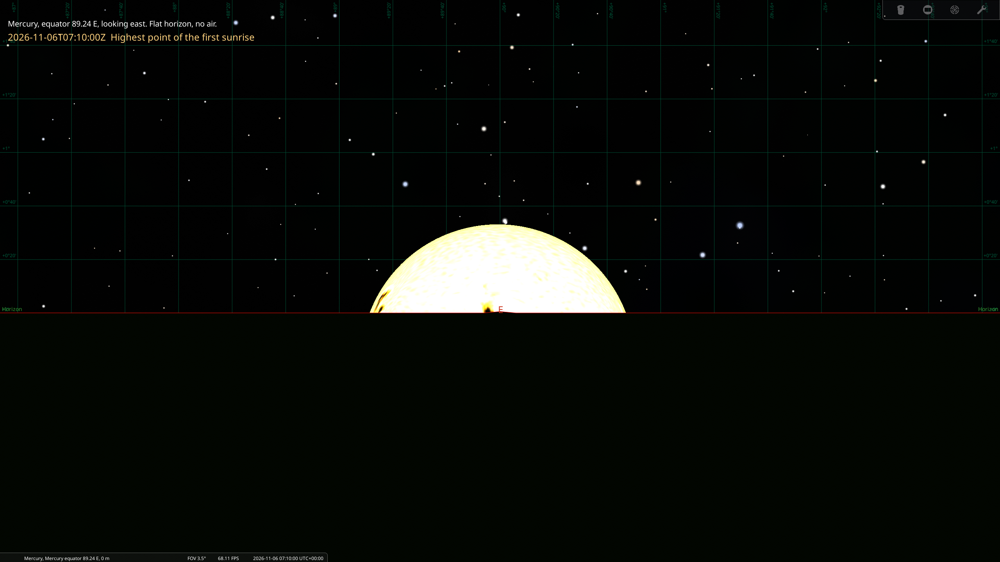

# Mercury's double sunrise

On some parts of Mercury, the Sun comes up, stops, goes back down, and comes
up again. This repository is for anyone who wants to check that claim and
see it for themselves. It does two things:

- It calculates when and where the next double sunrises happen.
- It gives a [Stellarium](https://stellarium.org/) script that shows one,
  as seen from Mercury's surface.



## Why it happens

Mercury turns three times on its axis for every two orbits of the Sun. Its
orbit is very eccentric (eccentricity 0.21). Near perihelion, the point of
the orbit closest to the Sun, Mercury moves along its orbit faster than it
turns. For about 8 Earth days the Sun moves backwards across Mercury's sky,
by about 1.1 degrees.

Look at a place where the Sun is at the horizon during those 8 days. There,
the Sun goes up, stops, goes back down, and comes up again. On the equator,
this place is near longitude 90 E or near longitude 90 W, and the two
places take turns. One perihelion gives a double sunrise at 90 E, and the
next one gives it at 90 W. At the same time, the other
place sees a double sunset.

Two facts limit what an observer sees:

- The backward motion (1.1 degrees) is smaller than the width of the Sun,
  which is 1.74 degrees from Mercury at perihelion. So the whole Sun never
  comes up and then fully sets again. At the best place, only the top third
  of the Sun shows, at most 0.56 degrees high. Then it goes out of sight,
  and then it rises for good.
- One "morning" on Mercury lasts weeks. A solar day on Mercury, from one
  sunrise to the next, is 176 Earth days. The first and the second sunrise
  are 14 Earth days apart.

## Next events

All places are on Mercury's equator, with a flat horizon. Longitudes are
planetocentric and positive to the east, which is the convention that
Stellarium uses. Times are in UTC. "Rise" and "set" refer to the top edge
of the Sun.

| Perihelion (UTC) | Double sunrise at | First rise | Sets again | Second rise |
|---|---|---|---|---|
| 2026-11-10 08:28 | 89.24 E | 2026-11-03 04:43 | 2026-11-10 08:28 | 2026-11-17 12:14 |
| 2027-02-06 07:44 | 90.76 W | 2027-01-30 04:00 | 2027-02-06 07:44 | 2027-02-13 11:27 |
| 2027-05-05 07:01 | 89.23 E | 2027-04-28 03:20 | 2027-05-05 07:01 | 2027-05-12 10:41 |
| 2027-08-01 06:17 | 90.77 W | 2027-07-25 02:37 | 2027-08-01 06:17 | 2027-08-08 09:58 |
| 2027-10-28 05:32 | 89.23 E | 2027-10-21 01:50 | 2027-10-28 05:32 | 2027-11-04 09:14 |

For each event, a double sunset happens at the same times near the
opposite longitude (89.03 W or 90.97 E). There, the top edge of the Sun
sets, comes back up, and sets again.

In the 2026 event, the top edge of the Sun is highest (0.56 degrees above
the horizon) on 2026-11-06 at 07:10 UTC. It is lowest (0.31 degrees below
the horizon) on 2026-11-14 at 09:46 UTC.

## Watch it in Stellarium

The script
[stellarium/mercury-double-sunrise.ssc](stellarium/mercury-double-sunrise.ssc)
puts you on Mercury at 89.24 E. You look east with a field of view of 3.5
degrees. Time runs at 20,000 times normal speed from 2026-11-02 to
2026-11-21, so the run takes about 80 seconds. A label names each stage.

### 1. Copy the script into Stellarium's scripts folder

The folder does not exist until you create it. Create it, then copy
`mercury-double-sunrise.ssc` into it.

#### Windows

The folder is `%APPDATA%\Stellarium\scripts`. File Explorer hides
`AppData`, so paste the path into the address bar. In PowerShell, from the
repository folder:

```powershell
New-Item -ItemType Directory -Force "$env:APPDATA\Stellarium\scripts"
```

```powershell
Copy-Item stellarium\mercury-double-sunrise.ssc "$env:APPDATA\Stellarium\scripts\"
```

#### macOS

```bash
mkdir -p ~/Library/"Application Support"/Stellarium/scripts
```

```bash
cp stellarium/mercury-double-sunrise.ssc ~/Library/"Application Support"/Stellarium/scripts/
```

#### Linux

```bash
mkdir -p ~/.stellarium/scripts
```

```bash
cp stellarium/mercury-double-sunrise.ssc ~/.stellarium/scripts/
```

### 2. Run the script

1. Start Stellarium, or restart it if it is open.
2. Press F2 to open the configuration window, and select the Scripts tab.
3. Select "Mercury's double sunrise" and click the run button.

Press Ctrl+M to stop the script early. Stellarium starts in full screen by
default. Press F11 to change between full screen and a window that you can
move.

The script changes the location, landscape and air pressure only for the
current Stellarium session. Your saved settings stay the same.

### Other events

To show another event, change `LON`, `AZ`, `START`, `END` and `EVENTS` at the
top of the script. Take the values from the `(full)` lines that
`compute.py` prints (see below). For a double sunset, use the sunset place
and set `AZ = 270`, which looks west.

Set `SNAPSHOTS = true` to save six still images instead of the animation.
The [screenshots](screenshots/) folder has these images for the 2026 event:

| Stage | Image |
|---|---|
| Before sunrise, 2026-11-02 12:00 UTC | [mercury-0-.png](screenshots/mercury-0-.png) |
| Highest point of the first sunrise, 2026-11-06 07:10 UTC | [mercury-1-.png](screenshots/mercury-1-.png) |
| Set again, 2026-11-12 00:00 UTC | [mercury-2-.png](screenshots/mercury-2-.png) |
| Lowest point, 2026-11-14 09:46 UTC | [mercury-3-.png](screenshots/mercury-3-.png) |
| Second sunrise, 2026-11-18 12:00 UTC | [mercury-4-.png](screenshots/mercury-4-.png) |
| Whole Sun up, 2026-11-21 00:00 UTC | [mercury-5-.png](screenshots/mercury-5-.png) |

### Why the script sets the air pressure to 0

Stellarium bends light near the horizon as Earth's air does, even on
Mercury, which has no air. This makes the Sun look 0.48 degrees higher at
the horizon. That is enough to hide most of the effect, so the script sets
the air pressure to 0.

## Calculate the events

[compute.py](compute.py) finds each perihelion in a date range. For each
one, it prints the places on the equator that see a double sunrise or a
double sunset. It also prints the UTC time of each horizon crossing. It
uses:

- the JPL DE440s ephemeris (a table of planet positions) through the
  [Skyfield](https://rhodesmill.org/skyfield/) library;
- the IAU model of Mercury's rotation that Stellarium also uses.

You need [uv](https://docs.astral.sh/uv/). Clone the repository:

```bash
git clone https://github.com/kvsankar/mercury-double-sunrise.git
```

```bash
cd mercury-double-sunrise
```

Then give the start date and the number of days to search:

```bash
uv run compute.py 2026-10-16 400
```

The first run downloads `de440s.bsp` (32 MB) from JPL. For each
perihelion, the output has two kinds of place:

- `(centre)`: the centre of the Sun crosses the horizon three times.
- `(full)`: the top edge of the Sun crosses the horizon three times, so
  the Sun goes fully out of sight between the two sunrises. The table above
  uses these places.

## How the results were checked

[stellarium/verify.ssc](stellarium/verify.ssc) prints the altitude of the
Sun in Stellarium at the times that `compute.py` predicts. With the air
pressure at 0, Stellarium 25.2 agrees with `compute.py` to within 0.015
degrees.

## Limits

- The horizon is a smooth sphere. Mercury's real surface has hills and
  crater rims, which often rise more than 1 degree above a flat horizon.
  At a real place, the times and the visibility depend on the local terrain.
- The places are exactly on the equator. Away from the equator, the Sun
  rises at a slant, and the effect is smaller.
- The rotation model is the one in Stellarium. It does not include
  Mercury's small libration, a slight rocking of its rotation. Other models
  can give times that differ by some minutes.
